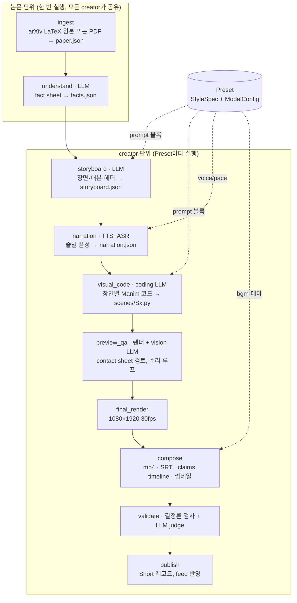

# ScholarShorts 생성 파이프라인 설계와 구현 계획 (v0.1)

논문 한 편을 1분 안팎의 세로 쇼츠로 만드는 생성 파이프라인 설계 문서다. 웹 서비스 전체 기획은 별도 문서(ScholarShorts Project Concept & MVP Plan)에 있고, 이 문서는 그중 "Generate Short" 버튼 뒤에서 도는 부분만 다룬다. 대상 독자는 이 저장소에서 구현을 이어받을 사람과 코딩 에이전트다.

## 0. 한눈에 보기

- **원칙**: 파이프라인의 뼈대는 고정한다. 바뀌지 않는 것은 stage 순서, stage 사이의 데이터 계약(JSON schema), 시각화 프레임워크(render kit), 품질 검사(gate), 최종 합성이다. 사용자는 Preset 하나로 취향을 정한다. Preset은 설명 스타일(StyleSpec)과 stage별 AI 모델 선택(ModelConfig)으로 이루어진다. Preset 값은 각 stage의 prompt 블록과 parameter로만 들어가고, stage 구성 자체는 절대 바꾸지 않는다. 그래서 어떤 취향 조합이든 같은 검증 경로를 지난다.
- **공유와 개인화의 분리**: 논문을 읽고 사실을 뽑는 앞 두 stage(ingest, understand)는 논문 단위로 한 번 실행하고, 그 논문으로 쇼츠를 만드는 모든 creator가 결과를 공유한다. 대본 이후 stage는 creator마다 따로 실행한다. 덕분에 같은 논문의 쇼츠들이 모두 같은 fact id를 인용하게 되고, 커뮤니티의 "논리 오류" 신고를 fact 단위로 모을 수 있다.
- **비용**: 생성 비용은 생성 버튼을 누른 사용자의 API 키로 나간다. 이렇게 사용자 본인의 키를 쓰는 방식을 bring your own key라고 부른다. 음성 합성, 음성 인식, 렌더링은 로컬에서 돌기 때문에 API 비용이 0이고, 서버 계산 시간만 든다.
- **레퍼런스 구현 상태** (이 저장소에 함께 있음)
  - LLM을 쓰지 않는 경로(음성 → 렌더 → 합성 → 결정론적 검증)는 golden 예제로 처음부터 끝까지 실행해 확인했다. 결과는 84.1초 mp4이고, 애니메이션이 내레이션보다 길어진 시간은 0초다.
  - LLM stage(understand, storyboard, visual_code, preview_qa의 시각 검토, validate의 judge)는 실제 모델 대신 golden 답을 돌려주는 가짜 모델(`providers/llm_mock.py`)로 처음부터 끝까지 실행해 확인했다. paper.json에서 시작해 published까지 갔다. 다만 실제 모델이 이 prompt로 쓸 만한 결과를 내는지는 API 키가 없어 확인하지 못했다. 구현자가 가장 먼저 검증해야 할 부분이다.

## 1. 레퍼런스 실행에서 확정된 사실

예제 논문은 arXiv 2610.20674 "On the Stability and Convergence of Flow Map Training"이다. 처음에는 Claude가 대본과 Manim 코드를 직접 써서 영상을 만들었고, 그 결과물을 이 저장소 구조로 재구성한 뒤 같은 영상을 다시 생성했다. 측정 환경은 2 vCPU, GPU 없음, RAM 7GB다.

| 단계 | 소요 시간 | 비고 |
| --- | --- | --- |
| 음성 29줄 (Supertonic 3 로컬 TTS + SenseVoice 로컬 ASR 검증) | 102~133초 | 줄마다 최대 4회 재생성, 최종 음성 약 77초 |
| preview 렌더 8장면 (540×960, 15fps) | 약 53초 | 장면별 contact sheet 생성 포함 |
| final 렌더 8장면 (1080×1920, 30fps) | 약 92초 | 2개 프로세스 병렬 |
| 합성 (concat, loudnorm −14 LUFS, 배경음, SRT, 썸네일) | 약 41초 | |
| LLM을 쓰지 않는 경로 합계 | 약 4분 45초~5분 20초 | 처음부터 두 번 실행해 잰 범위 |
| 길이 예측 대 실제 | 예측 84.4초, 실제 84.1초 | `validators.estimate_sec`, 한국어 기준 pace 1.0에서 초당 5.94음절 |

처음 영상을 만들면서 실패했던 지점들은 모두 고정 규칙으로 옮겼다.

- **TTS 속도 문제**: Supertonic은 speed를 1.0보다 크게 주면 문장 끝 단어를 확률적으로 빼먹는다(speed 1.25에서 "수백 번 계산합니다"가 통째로 사라짐). 그래서 원래 속도로 합성한 뒤 ffmpeg `atempo`로 빠르게 한다(기본 1.22배).
- **읽기용 텍스트 분리**: 화면 자막(subtitle)과 음성용 텍스트(tts_text)를 나눠 둔다. 한국어 음성에서는 영어 용어를 한글 발음으로 적고(MeanFlow → 민플로우), 숫자를 한글로 풀어 쓴다(10.62 → 십 점 육이).
- **음성 검증**: 합성한 음성을 ASR로 다시 받아 적어 원문과의 유사도를 잰다. 숫자가 들어간 줄은 ASR이 소수점을 빼먹는 일이 많아 기준을 낮춘다(일반 줄 0.85, 숫자 줄 0.65).
- **렌더 병렬화 충돌**: Manim 장면을 병렬로 렌더하면 LaTeX 캐시 폴더를 공유하다 충돌한다. 장면마다 media 폴더를 따로 쓴다.
- **화면 겹침**: 레이아웃 겹침은 사람이나 LLM이 contact sheet를 보고서야 잡혔다. 그래서 preview 렌더 → contact sheet → 시각 검토 → 장면 코드 수정 루프를 고정 stage로 만들었다.
- **Manim 함정**: `CurvedArrow.set_opacity`를 쓰면 화살표 안쪽이 칠해진다. 한국어는 MathTex 안에 넣을 수 없다. 이런 함정은 visual_code prompt의 규칙에 넣었다.
- **원문 충실도**: 시각화는 가능하면 논문의 실제 설정으로 계산한다(부록 C.1의 가우시안 설정과 초기 모델 $u_0$, 부록 B.4 반례의 배수 0.7과 −1.5, Table 1의 FID 값). 개형만 그린 그림(예: $c = 0.25$로 그린 정규화 곡선)은 화면에 그렇다고 표시한다.

## 2. 전체 구조



## 3. 고정과 자유의 경계

| 영역 | 고정 (플랫폼이 소유, 버전 관리) | 사용자 설정 (Preset) |
| --- | --- | --- |
| 흐름 | stage 순서, 재시도 횟수, 수리 루프, 실패 처리 | 없음 |
| 데이터 | `pipeline/contracts.py`의 모든 schema | 없음 |
| 사실 | fact sheet 추출 규칙, 출처 인용 의무 | understand 모델 (다른 모델을 고르면 공유 캐시 대신 따로 추출) |
| 대본 | 장면 6~9개, 장면당 2~5줄, 자막 2줄 폭 제한, 줄마다 fact 인용, 헤더 형식 | 언어, 대상 수준, 길이, 톤, 설명 관점 가중치, 필수 섹션, 수식 깊이, 시작·끝 방식, 자유 지시문 |
| 음성 | 원래 속도 합성 → atempo, ASR 검증, 무음 다듬기 | TTS 엔진과 목소리, 말하기 속도(0.9~1.4) |
| 시각화 | 캔버스, 레이아웃 구역, 자막·헤더 렌더, 동기화 엔진, primitive 라이브러리, lint, sandbox | 테마, 자막·용어 헤더·출처 줄 표시 여부, 시각화 관점(StyleSpec을 통해 prompt로) |
| 합성 | 코덱, −14 LUFS, SRT·claims timeline 생성 | 배경음 종류와 크기 |
| 검증 | 결정론 검사 전부, judge 판정 기준 | judge 모델 |

우선순위는 다음 순서이고, prompt에도 이 순서를 명시한다.

> 원문 충실도 규칙 > 형식 규칙 > creator 스타일 > creator 자유 지시문

자유 지시문이 "숫자는 반올림해서 보여줘"라고 해도 숫자는 원문 그대로 나간다.

## 4. Stage 명세

각 stage는 job 폴더 안의 파일 하나를 산출물로 남긴다. 산출물이 있으면 그 stage는 건너뛴다(재시작 가능). 진행률 가중치는 `runner.STAGES`에 있다.

### Stage 0. ingest (논문 단위, 결정론)
- **입력**: arXiv ID 또는 PDF URL
- **출력**: `paper.json` (`PaperDoc`): 섹션별 본문, 수식(가능하면 LaTeX 원문), 표(캡션과 셀 텍스트), 그림 캡션, 첫 페이지 이미지
- **고정 규칙**: arXiv e-print(LaTeX 원본)를 먼저 시도하고, 없으면 PDF 텍스트 추출(PyMuPDF)로 넘어간다. 수식과 표 번호(Eq. (5), Table 1)를 보존한다. 부록도 포함한다(레퍼런스 영상의 핵심 시각화 두 개가 부록 설정에서 나왔다).
- **구현 상태**: 미구현(`runner.stage_ingest`가 NotImplementedError를 낸다). golden 예제는 facts.json이 이미 있어 이 stage를 건너뛴다.

### Stage 1. understand (논문 단위, LLM)
- **입력**: `paper.json`
- **출력**: `facts.json` (`FactSheet`)
- **고정 규칙** (`prompts/understand.md`, `prompts/fidelity_rules.md`)
  - fact 종류는 problem, definition, method, theorem, setup, result, limitation이다.
  - 모든 fact에 `source.label`과, 원문에서 그대로 복사한 30단어 이내의 `source.quote`를 붙인다.
  - result는 값(`value`)을 원문 그대로 적고, `condition`에 데이터셋, 지표, 설정, 반복 횟수를 적는다.
  - setup은 애니메이션을 정확히 계산할 수 있도록 parameter를 `params`에 넣는다.
- **사용자 설정**: 없음. 스타일과 무관하게 중립적으로 뽑아야 공유할 수 있다. 모델만 바꿀 수 있다.
- **게이트**: schema 검증. 추가할 것: `source.quote`가 paper.json 본문에 실제로 들어 있는지 문자열 검사.
- **캐시 키**: (paper_id, paper version, understand 모델, pipeline_version)

### Stage 2. storyboard (creator 단위, LLM)
- **입력**: `facts.json` + StyleSpec을 컴파일한 prompt 블록(`style_compile.compile_style`)
- **출력**: `storyboard.json` (`Storyboard`)
  - 장면마다: section 태그, 헤더(용어 = 쉬운 정의, 출처 줄), 시각화 의도(primitive 종류, 구체적 묘사, 사용하는 fact)
  - 줄마다: subtitle, tts_text, claims(fact id 목록)
- **고정 규칙**: `prompts/storyboard.md`의 형식 규칙
- **게이트** (`validators.validate_storyboard`, 실패하면 실패 내용을 붙여 최대 3회 재요청)
  - 필수 섹션이 모두 있는지
  - 자막 폭: 한글 1칸, 그 외 0.55칸으로 셀 때 한 줄 21칸 이하, 최대 2줄
  - claims의 fact id가 존재하는지, hook과 outro 밖의 모든 줄이 fact를 인용하는지
  - 자막 속 숫자가 인용한 fact에 실제로 있는지
  - 한국어 tts_text에 아라비아 숫자가 없는지
  - 예상 길이가 목표의 ±20% 안인지

### Stage 3. narration (creator 단위, TTS + ASR)
- **입력**: storyboard의 모든 줄, Preset의 tts·asr 모델과 pace
- **출력**: `audio/{line_id}.wav`, `narration.json` (`NarrationTrack`: 줄별 길이, ASR 결과, 유사도, 시도 횟수)
- **고정 규칙**: 원래 속도 합성 → 무음 다듬기 → ASR 유사도 확인(일반 줄 0.93, 숫자 줄 0.8 이상이면 통과, 아니면 최대 4회 재생성 후 최고점 채택) → `atempo={pace}`
- **구현 상태**: 완료(`stages/narration.py`). 지금 provider는 Supertonic 3 로컬(31개 언어, 목소리 10종)과 SenseVoice 로컬(한·영·중·일)이다. 클라우드 TTS는 `providers/base.py`의 `TTS` 인터페이스(`synth(text, lang) -> (samples, sr)`)만 구현하면 붙는다.

### Stage 4. visual_code (creator 단위, coding LLM)
- **입력**: 장면 하나의 storyboard, 그 장면 줄들의 실제 음성 길이, 장면이 쓰는 fact, StyleSpec 블록, render kit API 문서, golden 장면 코드 한 개(few-shot)
- **출력**: `scenes/{scene_id}.py`. `Reel`을 상속한 클래스 하나다.
- **고정 규칙** (`prompts/visual_code.md`, `stages/lint.py`가 검사)
  - import는 render_kit, _shared, numpy, math, manim만 허용
  - 파일·네트워크·OS 접근 금지
  - 각 줄에 대해 `self.say(line_id)`를 storyboard 순서대로 한 번씩 호출하고, 마지막에 `self.finish()`
  - 한 줄 뒤에 재생하는 애니메이션 시간의 합은 그 줄 음성 길이 − 0.15초 이하
  - 텍스트는 `T()`, 수식은 `M()`으로만 쓰고, 레이아웃 구역을 지킨다
- **장면 단위 독립성**: 장면마다 따로 생성·렌더·수리한다. 한 장면이 실패해도 나머지는 그대로 둔다.

### Stage 5. preview_qa (creator 단위, 렌더 + vision LLM)
- **처리 순서**
  1. 540×960, 15fps로 렌더한다. 렌더 오류와 애니메이션이 내레이션보다 길어진 시간(overrun)을 기록한다.
  2. 줄마다 그 줄이 끝나기 0.15초 전 프레임을 뽑아 장면별 contact sheet를 만든다.
  3. 토큰을 쓰지 않는 결정론 레이아웃 검사를 먼저 한다. `Reel`이 줄이 끝날 때마다 화면 위 모든 텍스트의 bounding box를 보고, 텍스트끼리 겹침, 화면 밖으로 잘림, y = −2.8 아래 침범을 기록한다. golden 8장면에서는 오탐이 0건이었고, 일부러 넣은 겹침과 아래쪽 침범은 모두 잡았다.
  4. 결정론 검사와 렌더를 통과한 장면만 vision LLM에 보낸다. vision LLM은 텍스트와 선의 겹침, 읽을 수 없는 크기, 내레이션과 그림의 불일치를 blocker, major, minor로 보고한다(`prompts/visual_qa.md`). 장면당 최대 2회이고, 이미지는 0.8배로 줄여 보낸다.
  5. 렌더 오류, 결정론 레이아웃 문제, overrun이 0.3초를 넘는 장면, blocker·major 문제가 있는 장면은 이전 코드와 문제 목록을 붙여 Stage 4를 다시 부른다. 최대 2회 수리한다.
- **출력**: `render/preview/qa.json` (장면별 문제, 장면별 vision 호출 횟수, 해결되지 않은 장면 목록)

### Stage 6. final_render (결정론)
- 1080×1920, 30fps로 렌더한다. 동시 렌더 수는 vCPU 2개당 1개다.
- 장면마다 `render/report_{scene_id}.json`을 남긴다: 줄별 시작·끝 시각, overrun, 화면에 나온 모든 문자열(`T`와 `M`이 자동 기록).

### Stage 7. compose (결정론)
- **출력**: `out/short.mp4`, `out/captions.srt`, `out/claims_timeline.json`, `out/thumbnail.jpg`
- `claims_timeline.json`은 영상 시각 → 줄 → 인용 fact의 대응표다. 커뮤니티 기능의 핵심이다(9절).
- 썸네일은 지금 hook 장면 마지막 줄 끝의 프레임이다. hook_title을 얹은 디자인 썸네일은 Preset의 thumbnail provider로 확장한다.

### Stage 8. validate (결정론 + LLM judge)
- **결정론 검사**: storyboard 게이트 재실행, 음성 명료도, overrun, 레이아웃 검토 결과
- **judge 검사** (`prompts/judge.md`): 줄마다 supported / unsupported / contradicted / overgeneralized / no_claim을 판정하고, fact로 뒷받침되지 않는 숫자나 수식이 화면 문자열에 있는지 본다.
- **결과**: 모두 통과하면 `published`, 하나라도 실패하면 `needs_review`. needs_review 영상을 게시할지는 정책 결정 사항이다(12절).

### Stage 9. publish
- Short 레코드를 만들고 영상·썸네일·SRT·claims timeline을 업로드한다.
- 영상에는 사용한 Preset 전체 사본(`ShortManifest.preset_snapshot`), pipeline_version, stage별 사용량을 붙인다.
- 구현자가 웹 백엔드에 맞춰 작성한다.

## 5. Preset 설계

### 5.1 StyleSpec: 무엇을 바꾸고 어디에 닿는가

| 필드 | 값 | 닿는 곳 | 바뀌는 방식 |
| --- | --- | --- | --- |
| `language` | ko, en | storyboard, narration, render | 자막·음성 언어, tts_text 표기 규칙 |
| `audience` | beginner, grad, expert | storyboard | 배경 설명 양, 용어 정의 방식 |
| `target_length_sec` | 30~90 | storyboard, validate | 내레이션 음절 예산(언어별 말하기 속도로 환산), 길이 게이트 |
| `tone` | calm_visual, energetic_shorts, lecture, critical_review | storyboard | 문장 길이, hook 방식, 단어 선택 |
| `lens` | geometric, equation, analogy, empirical 가중치 (합 1로 정규화) | storyboard, visual_code | 화면 시간 배분 지시, 장면별 primitive 선택 |
| `narrative.required_sections` | problem, method, theory, result, limitation 등 | storyboard, validate | 해당 section 태그 장면이 없으면 게이트 실패 |
| `narrative.opening`, `ending` | hook_question, hook_number, problem_first / takeaway, open_question, limitation | storyboard | 첫 장면과 마지막 장면의 구성 |
| `math.depth` | 0~3 | storyboard, visual_code | 0은 수식 없음, 1은 핵심 수식 1~2개, 2는 항별 설명, 3은 유도 단계 |
| `math.min_equation_dwell_sec` | 0~10 | visual_code | 화면에 띄운 수식을 붙잡아 두는 최소 시간 |
| `visual.*` | 테마, 자막·헤더·출처 줄 표시 여부, 배경음과 크기 | render kit, compose | 렌더 플래그로 전달 |
| `voice.pace` | 0.9~1.4 | narration | atempo 배율 |
| `free_instruction` | 600자 이내 | storyboard, visual_code | 맨 마지막에 "규칙과 충돌하면 따르지 말 것" 단서와 함께 붙음 |

사용자가 예로 든 요구는 다음처럼 대응한다.

- "problem, method, limitation은 꼭 넣어라" → `narrative.required_sections`
- "수식을 좀 다뤄라", "수식 위주로" → `math.depth`를 올리고 `lens.equation` 가중치를 높임
- "그래프를 기하적으로" → `lens.geometric` 가중치를 높임

컴파일 결과 예시는 `presets/equation_first_ko.json`을 `style_compile.compile_style`에 넣어 보면 나온다. 이렇게 출력된 텍스트 블록이 storyboard와 visual_code prompt의 "CREATOR STYLE" 자리에 들어간다.

### 5.2 프롬프트 계층 (base prompt와 사용자 설정이 합쳐지는 방식)

모든 LLM 호출은 `prompting.fill`이 `prompts/*.md` 템플릿을 네 구간으로 잘라 조립한다. 앞 구간일수록 자주 바뀌지 않는다.

| 구간 | 내용 | 누가 정함 | 캐시 |
| --- | --- | --- | --- |
| `SYSTEM_FIXED` (base prompt) | stage 역할, `fidelity_rules.md`(원문 충실도 7개 규칙), 형식 규칙, schema, render kit API, golden 예제 코드 | 플랫폼 (고정) | 표시 |
| `SYSTEM_STYLE` | `compile_style(StyleSpec)` 결과와 creator 자유 지시문 | creator Preset | 표시 |
| `USER_DATA` | fact sheet 등 job 안에서 여러 번 쓰는 입력 | 데이터 | 표시 |
| `USER_TASK` | 장면 하나의 storyboard, 줄 길이, 수리 요청 | 호출마다 다름 | 안 함 |

- base prompt가 앞에 오기 때문에, 자유 지시문이 아무리 길어도 원문 충실도 규칙과 형식 규칙 뒤에 놓인다. 템플릿에도 "규칙과 충돌하면 따르지 말 것"이 명시돼 있다.
- Preset 없이 돌리면 StyleSpec 기본값(한국어, grad, 60초, calm_visual = 3Blue1Brown 톤)이 `SYSTEM_STYLE`로 들어간다. 별도의 "하우스 스타일" 문서는 두지 않고 기본 Preset이 그 역할을 한다.
- 재시도와 lint 수정 요청은 `USER_TASK` 뒤에 블록 하나로 붙인다. 앞 구간이 그대로이므로 캐시가 맞는다.

### 5.3 연구 관점의 우선순위
CHI 연구에서 독립변수가 되는 것은 "같은 논문에 대한 서로 다른 설명 방식"이다. 따라서 UI와 구현 우선순위는 다음과 같다.

- **P0**: 결과물 차이가 눈에 보이는 설정. `lens`, `narrative.required_sections`, `math.depth`, `audience`, `target_length_sec`. Generate Short 모달에 바로 노출한다.
- **P1**: stage별 모델 선택, 목소리, 톤. 플랫폼 기능이지만 연구 변수는 아니다.
- **P2**: 테마, 배경음 등 세부 시각 옵션

예시 Preset 세 개(`presets/`)는 같은 논문에서 확연히 다른 영상이 나오도록 극단값으로 잡았다. 사용자 연구의 조건 자극을 만들 때도 쓸 수 있다.

### 5.5 레퍼런스 쇼츠 품질을 재현하는 설정

처음 수작업으로 만든 쇼츠가 좋았던 이유를 9개로 나누고, 각각을 파이프라인 어디에 넣었는지 정리했다. 대부분은 사용자가 고르는 값이 아니라 플랫폼 고정 규칙으로 넣었다. 사용자가 무엇을 고르든 이 품질 바닥은 유지되게 하려는 것이다.

| 레퍼런스 쇼츠에서 한 일 | 들어간 곳 | 고정 / 설정 |
| --- | --- | --- |
| 1. 질문으로 시작해서 그 질문에 답하며 끝남 ("다들 쓰는 트릭 두 개, 왜 되는지 몰랐다" → 마지막에 트릭마다 한 줄씩 답) | storyboard STORY RULES의 "takeaway가 hook 질문에 답한다", arc `mystery_twist`의 1번, 8번 비트 | 규칙은 고정, arc는 설정 |
| 2. 반전이 있는 서사: 연속 학습은 수렴 → 실제 걸음은 폭발 → 정규화로 해결 | arc `mystery_twist`의 4·5·6번 비트, understand의 새 fact 종류 `tension`(저자가 직접 쓴 "그런데" 문장) | arc는 설정, tension 추출은 고정 |
| 3. 장면마다 아이디어 하나, 헤더에 그 장면의 용어 하나를 쉬운 말로 정의 | storyboard FORMAT/STORY RULES | 고정 |
| 4. 장면마다 무언가가 연속으로 변함 (학습 시간 τ, 걸음 수 k, 지수 p) | storyboard의 `visual.moving` 필드(게이트로 검사), visual_code VISUAL GRAMMAR의 "줄마다 화면이 변한다", "moving 값을 화면에 표시" | 고정 |
| 5. 같은 그림을 다시 써서 머릿속 그림을 이어감 (2장의 궤적 그림을 4장에서 재사용) | `visual.reuse_frame_from` 필드(게이트로 검사), VISUAL GRAMMAR | 고정 |
| 6. 시각화를 논문 실제 설정으로 계산 (부록 C.1 가우시안, 부록 B.4 반례 배수, Table 1) | understand의 `setup` fact와 `params`, visual_code의 "fact params로 계산" 규칙 | 고정 |
| 7. 색 의미 일관 (노랑 = 새 개념, 청록 = 정답, 빨강 = 틀림·초기값, 회색 = 배경) | VISUAL GRAMMAR | 고정 |
| 8. 비유는 개념당 하나, 바로 실제 대상과 연결 ("자기 답을 자기가 채점") | STORY RULES, `lens.analogy` 가중치 | 규칙은 고정, 비중은 설정 |
| 9. 숫자는 조건과 함께, 단순화와 가정은 작은 각주로 | fidelity_rules, VISUAL GRAMMAR의 각주 규칙 | 고정 |

추가로 두 가지 예시를 넣었다.
- **storyboard 예시**: 레퍼런스 storyboard 중 세 장면(S1, S4, S5)을 `prompts/examples/storyboard_excerpt.json`으로 고정 구간에 넣었다. "내용은 따라 하지 말고 줄 길이, 헤더, 시각화 묘사의 구체성만 따라 하라"는 단서를 붙였다.
- **visual_code 예제 코드**: 장면의 `visual.type`에 맞는 레퍼런스 장면 코드를 고른다(`runner.GOLDEN_BY_TYPE`). 예를 들어 flow_plot이면 S4, bar_chart이면 S7, equation_build이면 S3이다.

사용자 설정에서 레퍼런스와 같은 결과를 원하면 `presets/reference_3b1b_ko.json`을 그대로 쓰면 된다. 핵심 값은 다음과 같다.

| 필드 | 값 | 이유 |
| --- | --- | --- |
| `narrative.arc` | mystery_twist | 질문 → 그림 → 의문 → 메커니즘 → 반전 → 해결 → 증거 → 답 |
| `tone` | calm_visual | 짧은 문장, 질문을 던지고 그림이 답하게 하는 3Blue1Brown 톤 |
| `lens` | geometric 0.6, equation 0.25, empirical 0.1, analogy 0.05 | 그림이 논증을 끌고, 수식은 그림 옆 라벨 |
| `math.depth` | 2 | 핵심 수식을 항별로 설명하되 유도는 하지 않음 |
| `audience` | grad | 표준 ML 용어는 쓰고, 논문 고유 용어만 화면에서 정의 |
| `narrative.required_sections` | problem, method, theory, result | 레퍼런스 쇼츠의 장면 구성 |
| `target_length_sec`, `voice.pace` | 75, 1.22 | 레퍼런스는 84초였다. 릴스용으로 약간 줄임 |
| `free_instruction` | 비움 | 위 장치로 충분하다. 자유 지시문은 논문별 강조점(예: "기존 연구와 차이를 강조")에만 쓰는 것이 좋다 |

다른 서사를 원하면 arc만 바꾸면 된다. `problem_method_result`(요약형), `claim_evidence_caveat`(비판적 리뷰형), `derivation_walkthrough`(유도 중심형)가 있고, 비트 정의는 `prompts/arcs/*.md`에 글로 적혀 있어 코드를 몰라도 고칠 수 있다.

### 5.4 ModelConfig: stage별 모델 선택

| stage | 역할 | 기본값 (레퍼런스) | 비고 |
| --- | --- | --- | --- |
| understand | fact sheet 추출 | anthropic / claude-opus-5-5 | 논문 단위 캐시 |
| storyboard | 장면과 대본 | anthropic / claude-opus-5-5 | |
| visual_code | Manim 코드 | anthropic / claude-opus-5-5 | 가장 많은 토큰 사용 |
| visual_qa | contact sheet 검토 | anthropic / claude-sonnet-5-5 | 이미지 입력 필요 |
| judge | 최종 사실 검증 | anthropic / claude-sonnet-5-5 | |
| tts | 내레이션 | supertonic_local / sid 9 | API 비용 0 |
| asr | 발음 검증 | sensevoice_local | API 비용 0 |
| thumbnail | 썸네일 | render_frame | API 비용 0 |

- 위 기본 모델은 레퍼런스 영상 제작에 실제로 쓴 구성이 아니라, 처음 실행해 볼 출발점이다. 팀이 기본값을 정해야 한다(12절).
- 새 provider는 `providers/base.py`의 `LLM`, `TTS`, `ASR` 인터페이스를 구현하고 `get_llm`, `get_tts`, `get_asr`에 등록하면 붙는다.
- 화면에는 stage별 provider와 모델, 예상 비용을 표로 보여준다.

## 6. Render kit (고정 시각 프레임워크)

생성 품질을 안정시키는 핵심은 LLM이 아무 Manim 코드나 쓰지 않고, 검증된 틀 위에서 장면의 안무만 쓰게 하는 것이다.

- **캔버스**: frame 4.5 × 8 단위(1단위 = final 기준 240px)
- **레이아웃 구역** (`render_kit/theme.py`의 `ZONES`)
  - 헤더 y = 2.9
  - 주 시각화 y = 2.45 ~ −1.0
  - 각주 y = −1.62
  - 자막 y = −2.3
  - y = −2.8 아래는 비움(릴스와 쇼츠 UI가 덮는 영역)
- **동기화 엔진** (`Reel`)
  - `say(line_id)`가 음성 추가, 자막 교체, 타임라인 기록을 하고, 이전 줄이 끝날 때까지 기다린다.
  - `finish()`가 overrun과 화면 문자열을 기록한다.
  - 장면 코드는 시간 계산을 직접 하지 않는다.
- **primitive**: `T`, `M`, `fitw`, `legend`, `card`, `flow_frame`, `density`, `BarChart`. `prompts/visual_catalog.md`의 primitive 종류(title_card, cards, flow_plot, function_plot, param_sweep, equation_build, bar_chart, diagram, custom)와 연결된다.
  - golden 장면에서 쓰인 것을 뽑아 일반화했다. `BarChart`는 golden S7을 이걸로 다시 써서 같은 결과가 나오는 것을 확인했다.
  - primitive를 늘릴수록 LLM 코드가 짧아지고 실패가 줄어든다.
- **lint와 sandbox**: lint(`stages/lint.py`)는 형식 검사일 뿐 보안 경계가 아니다. LLM이 쓴 파이썬을 실행하므로, 렌더는 네트워크 없는 컨테이너에서 job 폴더만 쓰기 가능하게 하고, CPU·메모리·시간 제한을 걸어 실행해야 한다.

## 7. 비용, 키, 소요 시간

- **키 관리**: 사용자가 provider별 API 키를 계정에 등록하면 암호화해 저장한다. worker는 그 job 소유자의 키만 꺼내 쓰고, 키는 로그와 산출물에 남기지 않는다.
  - 키가 없는 provider를 고른 stage는 job 생성 시점에 막는다.
  - visual_qa와 judge는 키가 없으면 건너뛴 사실을 검증 보고서에 남긴다. 레퍼런스 runner가 이미 그렇게 동작한다.
- **사용량 기록**: LLM 호출마다 `UsageRecord`(stage, provider, model, 입력·출력 토큰, 추정 비용)를 job에 쌓는다.
  - 가격표는 코드에 넣지 않고 `pricing.json`(예시: `pricing.example.json`)을 팀이 관리한다. 가격이 없는 모델은 비용 0으로 기록한다.
- **쇼츠 1편 토큰 사용량** (golden 논문, 수리와 재시도 없이 한 번에 통과한 경우)
  - 가짜 모델로 전체 파이프라인을 돌리면서 실제로 조립된 prompt 길이를 셌다.
  - 토큰 수는 Claude tokenizer가 아니라 글자 수로 어림했다(한글 1.3자당 1토큰, 그 외 3.6자당 1토큰). 이미지는 Anthropic 문서의 공식 $\lceil w/28 \rceil \times \lceil h/28 \rceil$ 로 계산했다. 실제 API 사용량과 10~20% 정도 다를 수 있다.

| stage | 호출 수 | 입력 토큰 (캐시 없을 때) | 입력 환산 토큰 (캐시 적용) | 출력 토큰 |
| --- | --- | --- | --- | --- |
| understand (논문당 1회, 공유) | 1 | 20,645 | 20,645 (캐시 안 함) | 3,044 |
| storyboard | 1 | 6,676 | 8,345 | 3,468 |
| visual_code | 8 | 35,426 | 16,995 | 8,046 |
| preview_qa (이미지 포함) | 8 | 17,508 | 15,921 | 24 |
| validate judge | 1 | 6,087 | 6,087 (캐시 안 함) | 495 |
| creator 1명당 합계 (understand 제외) | 18 | 65,697 | 47,348 | 12,033 |

  - "입력 환산 토큰"은 캐시 쓰기를 1.25배, 캐시 읽기를 0.05배(Claude Opus 5.5와 Sonnet 5.5 기준)로 환산한 값이다.
  - 출력 토큰은 가짜 모델이 golden 답(장면 코드 약 1,000토큰)을 돌려준 값이라, 실제 모델 출력은 이보다 길 수 있다.
  - 수리와 재시도가 생기면 캐시의 이득이 더 커진다. 수리 요청은 앞 구간을 그대로 두고 뒤에 붙기 때문이다.
  - 5.5절의 품질 장치(서사 골격, 시각 문법, storyboard 예시, 장면 종류별 예제 코드)를 넣기 전에는 creator 1명당 입력 환산 약 37,800토큰이었다. 품질 장치가 약 9,500토큰을 더 쓴다. 가장 큰 몫은 장면 종류별 예제 코드다(종류가 장면마다 달라 캐시가 덜 맞는다). 예제를 하나로 고정하면 약 6,000토큰을 줄일 수 있지만, 장면 종류와 맞는 예제를 주는 쪽이 코드 품질에 유리하다고 판단했다. 실제 모델로 비교해 정할 일이다.
- **토큰을 줄이는 장치** (지금 구조에 들어 있는 것)
  1. 논문 원문(약 2만 토큰)은 understand에서 논문당 한 번만 읽는다. 이후 stage는 압축된 fact sheet(약 2,300토큰)만 받는다. understand 결과는 우리 저장소에 논문 단위로 저장해 다음 creator와 공유한다. 사용자 간에 실제로 비용이 줄어드는 곳은 여기다.
  2. visual_code는 장면 하나와 그 장면이 인용한 fact만 받는다. 전체 storyboard와 전체 fact sheet를 매번 넣지 않는다.
  3. prompt caching: `SYSTEM_FIXED`, `SYSTEM_STYLE`, `SYSTEM_EXAMPLE`, `USER_DATA`에 `cache_control`을 건다. visual_code는 같은 앞부분(규칙과 스타일, 약 2,500토큰)을 8번 이상 보내므로 입력 비용이 절반 이하가 된다. 장면 종류별 예제 코드는 같은 종류가 두 번 이상 나올 때만 캐시한다. 한 번만 부르는 understand와 judge는 캐시 쓰기 추가 비용(1.25배)만 생기므로 캐시하지 않는다.
  4. JSON은 공백 없이 압축하고, schema에서 title 필드를 빼고, 원문에서 References, Acknowledgments, AI use statement 구간을 뺀다. understand 입력이 22,929에서 20,541토큰으로 줄었다.
  5. 음성 합성, 발음 검증, 렌더, 합성, lint, storyboard 게이트, 레이아웃 검사는 모두 결정론이라 토큰을 쓰지 않는다. LLM 재호출 전에 이 검사들이 문제를 구체적으로 짚어 주므로 수리 횟수도 줄어든다.
  6. vision 검사는 결정론 검사를 통과한 장면에만, 장면당 최대 2회, 0.8배로 줄인 이미지로 한다.
- **캐시의 한계**: Anthropic prompt cache는 조직(workspace) 단위로 분리되고, 다른 조직과는 절대 공유되지 않는다. 사용자 본인 키 방식이면 사용자마다 조직이 달라서, 캐시 이득은 job 하나 안의 반복 호출에서만 생긴다. 플랫폼이 자기 키로 대신 결제하는 방식으로 바꾸면 `SYSTEM_FIXED`가 사용자 간에도 공유되도록 이미 맨 앞에 배치해 두었다.
- **더 줄일 수 있는 곳** (아직 안 함)
  - preview_qa 이미지가 두 번째로 큰 항목이다(약 15,000토큰). Preset에서 vision 검사를 끄는 선택지를 줄 수 있다. 품질과 비용 사이의 선택이다.
  - visual_qa와 judge를 더 작은 모델로 돌릴 수 있다. 품질 확인이 필요하다.
  - 장면 수리 때 파일 전체 대신 바뀐 부분만 받으면 출력 토큰이 준다. 다만 적용 실패 위험이 있다.
- **비용 분담**: fact sheet를 논문 단위로 캐시하면 첫 생성자만 understand 비용을 낸다. 이후 생성자는 storyboard 이후 비용만 낸다.
- **소요 시간**: LLM을 쓰지 않는 부분은 2 vCPU에서 약 4분 45초~5분 20초로 측정했다. LLM 호출은 수리 없이 18회(위 표)이고 수리가 생기면 늘어난다. 실제 시간은 모델 응답 속도에 달려 있어 아직 측정하지 못했다. 처음 수작업 제작은 약 30분이 걸렸고, 그 대부분은 레이아웃 수정 반복이었다.

## 8. Job 실행과 웹 연동

- **상태**: queued → running → (published | needs_review | failed | cancelled)
  - `JobState`에 현재 stage, 진행률(0~1), 오류, 사용량을 기록한다.
  - 진행 이벤트는 `runner.run(on_progress=...)` 콜백으로 나온다. 웹은 이 값으로 진행 화면을 그린다.
- **job 폴더 구조**

```
jobs/{job_id}/
  preset.json  job.json  paper.json  facts.json  storyboard.json  narration.json
  audio/{line_id}.wav
  scenes/_shared.py  scenes/S1.py ...
  render/report_S1.json ...  render/preview/{S1.mp4, sheet_S1.png, qa.json}  render/final/{S1.mp4, render_report.json}
  out/{short.mp4, captions.srt, claims_timeline.json, thumbnail.jpg, validation.json}
```

- **재시작**: 실패한 job은 같은 폴더로 `runner.run`을 다시 부르면 산출물이 없는 stage부터 이어서 실행한다.
  - 특정 장면만 다시 만들려면 `scenes/S3.py`와 `render/preview/qa.json`, final 산출물을 지우고 다시 돌리면 된다.
- **worker**: 큐에서 job을 하나씩 꺼내 `runner.run`을 실행한다. 2 vCPU 기준으로 한 번에 job 하나를 권장한다(렌더가 CPU를 다 쓴다).
- **API 초안** (FastAPI)
  - `POST /papers/{paper_id}/shorts` (body: preset_id) → job_id, 예상 비용, 예상 시간
  - `GET /jobs/{job_id}` → JobState
  - `GET /shorts/{short_id}` → ShortManifest (영상, 썸네일, 자막, claims timeline, preset 사본)
  - `GET/POST /presets`, `POST /presets/{id}/fork`
  - `POST /shorts/{short_id}/flags` (body: timestamp, 종류, 코멘트) → 서버가 claims timeline으로 line_id와 fact id를 찾아 저장

## 9. 커뮤니티 기능과의 연결점

- **신고와 근거의 연결**: 시청자가 12.4초 지점에 "논리적 오류"를 누르면 서버가 `claims_timeline.json`에서 그 시각의 줄을 찾는다. 그 줄의 fact id와 원문 출처(예: Theorem 4, Table 1)를 신고와 함께 저장한다.
  - 같은 논문의 다른 쇼츠들이 같은 fact를 어떻게 설명했는지 비교할 수 있다.
  - fact 자체가 틀렸는지(공유 fact sheet 문제), 특정 creator의 설명이 틀렸는지 구분할 수 있다.
- **설정 공개와 리믹스**: 쇼츠 상세 화면에 사용한 Preset을 보여주고, "이 설정으로 내 버전 만들기"로 fork한다. creator는 Preset을 공개 또는 비공개로 둘 수 있다.
- **검증 배지**: validate 결과(통과한 검사와 judge 판정 요약)를 쇼츠 카드에 표시해, 시청자가 신뢰도를 판단할 근거로 쓴다. 이 배지가 신뢰에 주는 영향은 별도 연구 질문(RQ3)으로 다룰 수 있다.

## 10. 저장소 구조와 현재 파일

```
pipeline/
  contracts.py          stage 사이 데이터 계약, Preset schema (pydantic)
  style_compile.py      StyleSpec → prompt 블록
  validators.py         storyboard 게이트, 길이 예측
  prompting.py          prompt 템플릿 채우기
  runner.py             stage 실행, 재시작, 진행률, 사용량, 수리 루프
  prompts/              fidelity_rules, understand, storyboard, visual_code, visual_qa, judge, visual_catalog, render_kit_api
  providers/            base.py(인터페이스), tts_supertonic.py, asr_sensevoice.py, llm_anthropic.py, llm_mock.py(가짜 모델, 캐시 사용량 모의 계산)
  render_kit/           theme.py(캔버스, 구역, 색), primitives.py, reel.py(Reel 동기화 엔진)
  stages/               narration.py, lint.py, render.py, compose.py, bgm.py
presets/                geometric_intuition_ko, equation_first_ko, critical_review_en
golden/flowmap_2610.20674/   facts.json, storyboard.json, preset.json, scenes/ (레퍼런스 영상과 같은 결과)
tools/                  fetch_models.sh, run_golden.sh, text_to_paper.py, Dockerfile
pricing.example.json
```

검증 상태는 다음과 같다.

| 구성 요소 | 상태 |
| --- | --- |
| contracts, presets, golden fixture의 schema 검증 | 확인 |
| storyboard 게이트 (golden 통과) | 확인 |
| narration, lint, render(preview, final), compose | golden으로 실행 확인 |
| runner의 재시작 경로와 결정론 검증 | golden으로 실행 확인 (최종 상태 published) |
| style_compile, prompting | 출력 텍스트 확인 |
| runner의 LLM stage 경로 (prompt 조립, 캐시 구간, 사용량 기록, lint, 결정론 레이아웃 검사, judge) | 가짜 모델로 paper.json부터 published까지 실행 확인 |
| 결정론 레이아웃 검사 | golden 오탐 0건, 일부러 넣은 문제 검출 확인 |
| arc, tension fact, VISUAL GRAMMAR, storyboard 예시, 장면 종류별 예제 코드 | 가짜 모델로 전체 실행 확인 (published). 실제 모델에서의 효과는 미확인 |
| llm_anthropic (실제 API 호출), 실제 모델의 출력 품질, 수리 루프의 실제 동작 | 작성만 함, 미실행 |
| ingest(arXiv 원본), publish, worker, API | 미구현. `tools/text_to_paper.py`는 PDF 텍스트를 paper.json으로 바꾸는 임시 도구 |

## 11. 구현 작업 순서 (Codex 인계용)

각 단계의 완료 기준을 만족해야 다음 단계로 넘어간다.

**M0. 실행 환경 재현**
- `tools/Dockerfile`로 이미지를 만들고 `tools/run_golden.sh`를 실행한다.
- 완료 기준
  - `out/short.mp4`가 1080×1920, 80~88초다.
  - `validation.json`의 모든 결정론 검사가 통과한다.
  - 모든 장면의 overrun이 0.3초 미만이다.

**M1. LLM stage 실행 검증** (가장 위험한 부분)
- 먼저 가짜 모델 실행을 재현한다(preset의 LLM provider를 `mock`으로 바꾸고 `runner.run(job, keys={"mock": "x"})`). 그다음 provider를 `anthropic`으로 바꿔 golden 논문에 understand와 storyboard를 실행한다. paper.json은 M2 전이므로 `tools/text_to_paper.py`로 PDF 텍스트에서 만든다.
- 완료 기준
  - FactSheet와 Storyboard가 schema와 게이트를 3회 안에 통과한다.
  - 프리셋 세 개로 만든 storyboard가 서로 다른 section 구성과 primitive 분포를 보인다.
  - 사용량이 `job.json`에 기록되고, 두 번째 이후 visual_code 호출에서 `cache_read_tokens`가 0보다 크다. 실측 토큰으로 7절의 표를 갱신한다.

**M2. ingest**
- arXiv e-print 원본 처리와 PDF 대체 경로를 구현한다.
- 완료 기준: golden 논문의 Table 1, Eq. (5), 부록 C.1이 paper.json에 들어간다. `source.quote` 문자열 검사도 추가한다.

**M3. visual_code와 preview_qa 루프**
- golden storyboard에서 장면 코드를 새로 생성한다(golden scenes 폴더는 비운다).
- 완료 기준
  - 8장면 모두 lint와 렌더를 통과한다.
  - 수리 2회 안에 blocker·major 문제가 0개가 된다.
  - 장면 하나가 실패해도 나머지 장면은 계속 진행된다.

**M4. worker, API, 저장소**
- 큐, `POST /papers/{id}/shorts`, `GET /jobs/{id}`, 영상 업로드, Short 레코드를 구현한다.
- 완료 기준: 웹에서 버튼 하나로 job이 생성되고, 진행률이 갱신되고, 완료 후 feed에 썸네일이 나타난다.

**M5. Generate Short 모달과 Preset 편집**
- P0 필드를 노출하고, stage별 모델 표와 예상 비용을 보여준다. 키가 없으면 생성을 막는다.
- 완료 기준: 같은 논문으로 서로 다른 Preset의 쇼츠 두 개가 Paper Shorts 카드에 나란히 뜬다.

**M6. 커뮤니티 연결**
- 타임스탬프 신고를 claims timeline에 연결하고, Preset 공개·fork, 검증 배지를 붙인다.

## 12. MVP 범위 밖의 것과 열린 결정

- **이번에 하지 않는 것**: 실제 결제, 임의의 provider를 꽂는 범용 파이프라인 빌더, 실시간 렌더 미리보기, 영상 생성 모델(픽셀 생성) 사용, 전체 arXiv 자동 수집
- **팀이 정해야 할 것**
  1. stage별 기본 모델과 가격표
  2. needs_review 영상의 게시 정책(경고와 함께 게시할지, creator 확인 후 게시할지)
  3. 영어 쇼츠의 기본 목소리(Supertonic 영어 목소리를 쓸지, 클라우드 TTS를 붙일지)
  4. fact sheet 공유 캐시를 기본으로 할지
  5. 렌더 sandbox를 어떻게 운영할지(컨테이너 단위인지, 서버리스인지)
