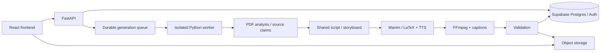

# 구현 구조와 확장 계약

## 현재 구조

```text
src/
  App.tsx                   화면·검색·필터·논문 상태 및 모달 조합
  components/PaperCard.tsx   Paper Feed / Paper Shorts 공용 카드
  components/Explore.tsx     video-first 탐색, 평가·댓글·follow
  components/Studio.tsx      설명 설정과 preset 입력
  components/Modal.tsx       native dialog (focus / Escape)
  hooks/useLocalState.ts     브라우저 영속 상태
  data/papers.json           수집한 원문 메타데이터 20편
  data/shorts.json           가상 사용자 데모 12개 및 실제 영상 manifest
  types.ts                  Paper / Short / Preset / Job 계약
  styles.css                반응형 레이아웃 및 디자인 토큰
public/previews/             PDF 1페이지 이미지 20개
public/videos/               사용자 샘플 MP4 위치
scripts/collect_papers.py    arXiv 메타데이터·PDF 수집과 rasterization
```

원본 PDF는 `.cache/papers/`에만 보관하고 git에서는 제외한다. 미리보기와 출처를 함께 제공한다. arXiv의 최신 메타데이터를 가져오므로 후속 버전에서 제목이나 저자 표기가 바뀔 수 있다. curated 목록은 최신 자동 추천 feed를 의미하지 않는다. 각 논문의 날짜와 수집일을 별도 저장한다.

Paper Feed ↔ Paper Shorts는 같은 search/topic/sort 상태와 Paper 리스트를 공유한다. 저장된 생성 설정은 job별 snapshot으로 고정한다. 데모 job은 20초 후 ready가 되고 **videoUrl=null, demo=true**인 Short preview를 만든다. 재시작 시 경과 시간으로 완료되지만 실제 worker나 rendering이 아니다. 취소 job은 결과를 만들지 않는다. 데모 프리뷰는 실제 영상 수에 포함하지 않는다. 브라우저 localStorage 키는 `ss-*`이며 다른 사용자와 공유되지 않는다.

## 실제 서비스 단계



`Paper 1:N Short`, `User 1:N Short`, `Preset 1:N GenerationJob`. 단일 API 요청이 render를 기다리지 않는다. 실제 구현 시 `POST /generation-jobs` → 202 + id; `GET /generation-jobs/:id` polling/SSE; `POST /generation-jobs/:id/cancel`; `GET /papers/:id/shorts`. job 상태는 queued / analyzing / scripting / rendering / validating / ready / failed / cancelled. DB 상태는 worker만 권한 내에서 갱신한다.

Short asset 생성 후 URL을 제공하며 validation 또는 moderation이 실패하면 publish하지 않는다. 비용 추정은 실제 provider price와 usage를 기반으로 서버에서 수행한다. frontend에는 비밀 키나 모델 실행 코드를 넣지 않는다. GitHub Pages는 정적 frontend만 제공한다.

## 현재 범위의 한계

인증, 공유 DB, 실제 모델 API, 실제 render, 결제, 자동 추천 학습, 실사용 creator 프로필은 후속 단계다. Creator Studio는 로컬 프리셋과 activity만 제공한다. 댓글·follow·평가는 브라우저 데모다. 탐색에는 가상 사용자 8명의 데모 Shorts 12개가 있으며 실제 영상은 없다. 직접 만든 SVG 썸네일은 `public/thumbnails/`, 재생성 스크립트는 `scripts/create_demo_shorts.py`에 있다. 댓글 입력은 항상 표시하며 실제 사용자 댓글·평가는 localStorage에만 저장한다. 외부 샘플 등록 후 실영상 검증이 필요하다.

## 현재 backend 구현 추가

참조 ZIP을 `backend/`에 도입하고 FastAPI/SQLite/worker 구조를 구현했다. 이 문서 위의 Supabase 구성은 향후 멀티유저 구조이며, 현재 로컬 owner backend의 실행 계약은 [BACKEND.md](BACKEND.md)를 따른다. API 키는 서버 env에서만 읽고 Vite는 owner token을 서버 프록시에만 사용한다. 생성 단계와 render kit는 reference를 유지하며 generated Python은 Docker 격리 경로로만 실행한다. Docker가 없는 현재 환경에서는 새 생성이 차단된다. golden regression만 hash가 같은 원본 코드에 한해 로컬로 실행한다.

`src/components/ShortCover.tsx`는 데모/실제 영상 공통 썸네일이다. 제공받은 Flow Map 샘플 1개와 데모 12개를 구분한다. 서버에서 게시한 결과는 `/api/shorts`로 읽어 정적 manifest와 합친다. 기존 댓글/반응은 localStorage이고, 서버 timestamp→fact 신고 API는 별도로 구현했다.

### Budgeted Drifting comparison

`backend/experiments/`는 production worker와 분리한 수동 실행 실험이다. GPT‑5.4 mini / Claude Sonnet 5.5가 arXiv:2602.04770v2의 PDF 전체 텍스트에서 근거·한국어 대본·장면 JSON을 생성한다. 정확한 원문 인용과 모델 자체 사실 검토를 거친다. 현재 컨테이너에 Docker 격리 기능이 없어 **생성 Python은 실행하지 않는다**. 대신 직접 작성한 `visuals.py`가 여섯 가지 고정 애니메이션에 JSON 텍스트만 넣고 로컬 TTS 및 FFmpeg로 합성한다. 기존 Manim 자동 코드 생성 파이프라인과 구별되는 baseline이다. 자유로운 시각화 코드 생성 성능 비교가 아니다.

공급자별 $1 비용 상한을 요청 전에 보수적으로 예약하며, SDK 자동 재시도를 끈다. 응답 중단/실패로 usage가 없으면 예약액을 유지한다. 실제 토큰·수정 요청·단계 시간은 ignored `backend/data/experiments/*/report.json`에 기록한다. 키/전체 환경은 기록하지 않는다. 완료 결과를 검토한 뒤 정적 manifest로 등록한다. API worker의 Docker 요건은 완화하지 않는다.

### 논문별 Shorts 이동

초록 카드의 `쇼츠 버전 보기`와 논문 상세의 같은 버튼은 `shortsPaperId`를 설정해 해당 논문의 Shorts 목록만 표시한다. 검색/주제/정렬 상태는 그대로 유지하며 `초록 목록으로` 또는 `전체 쇼츠 목록`으로 범위를 해제할 수 있다. 영상이 없는 논문에서도 생성 진입용 empty state를 볼 수 있다. 영상 타일을 선택한 후에만 Explore로 이동한다.

### Inline paper cards (supersedes scoped Shorts page)

초록 화면에서 쇼츠 버튼을 누르면 `flippedPapers`에 해당 ID만 토글하여 카드 내부만 전환한다. 다른 논문·검색·정렬·페이지는 유지한다. 다시 누르면 초록으로 돌아온다. 각 카드의 ResizeObserver가 실제 가용 폭으로 열 수를 계산하며, Shorts 개수가 마지막 행을 정확히 채우면 Your Perspective 타일을 생략한다. 빈 슬롯이 있으면 남는 칸만 사용한다. 모바일 썸네일 최소 폭을 낮춰 일반 휴대폰에서는 두 개를 나란히 볼 수 있다. reduced-motion에서는 전환 애니메이션을 끈다.
